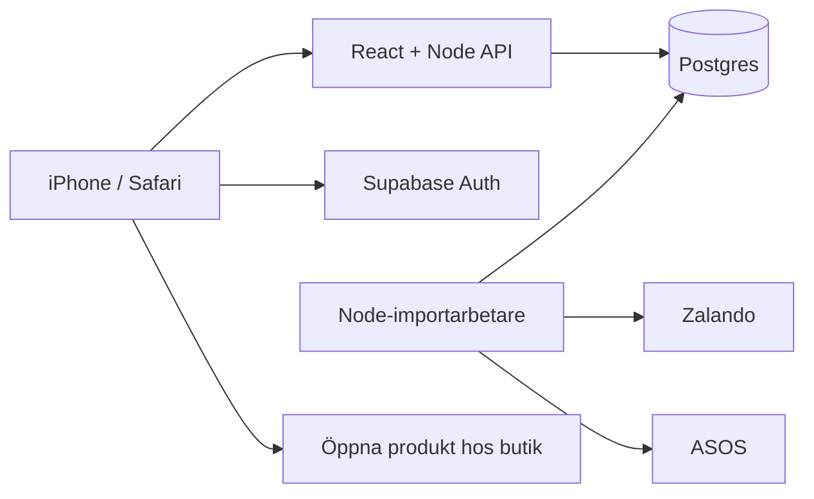

# Privat klädapp – byggplan

Planeringsförslag, 29 oktober 2026. Ingen app eller driftsättning skapas i detta steg.

## Mål för första versionen

En privat webbsida för Safari på iPhone. Användaren kan importera herrkläder
från Zalando och ASOS, se ett plagg åt gången, öppna alla produktbilder och
swipa vänster för att hoppa över eller höger för att gilla och spara.
Produkter och beslut finns kvar efter omladdning och på andra enheter efter inloggning.
Köpet sker hos butiken. Recensioner och maskininlärning ingår inte i version 1.

## Rekommenderade komponenter

| Del | Teknik | Ansvar |
| --- | --- | --- |
| Mobilgränssnitt | React + TypeScript + Vite | Kortlek, bildgalleri, favoriter, importstatus och filter |
| Webbserver/API | Node.js + Express | Servera byggd webbapp, verifiera användare, läsa data och spara beslut |
| Importarbetare | Node.js | Köra de befintliga butikshämtarna som bakgrundsjobb |
| Databas | Supabase Postgres | Produktdata, bilder, pris- och attributversioner, användarhistorik och jobb |
| Inloggning | Supabase Auth | Ett tillåtet konto till att börja med; ingen öppen registrering |
| Drift | En permanent Node-värd med HTTPS | Webbserver och separat arbetarprocess, plus extern Supabase-databas |

Webbservern kan servera frontend och API från samma domän. Arbetaren kör separat
så en import inte är beroende av en öppen flik eller en lång HTTP-förfrågan.
Detta kräver en värd som kan köra bestående Node-processer. Enbart statisk
webbhosting räcker inte för importdelen. Exakt värd och eventuell domän väljs
vid implementation; inga abonnemang eller kostnadsnivåer antas i denna plan.

Supabase är ett förslag, inte ett redan anslutet konto. Databasen kan ersättas
med annan Postgres utan att butikshämtarna behöver skrivas om.

Arkitektur:



## Första versionens vyer

### Upptäck

Ett stort produktkort, med bilden i fokus. Visa butik, märke, produktnamn,
aktuellt pris och faktisk valuta. Vid rea visas en tydlig REA-markering och
butikens jämförelsepris, med förklaring av vad det priset avser när det finns.
Ett pris som varierar mellan storlekar markeras som ett frånpris när källan
anger det. Priset är en ögonblicksbild, inte ett löfte om pris vid kassan.

Vänsterswipe = hoppa över. Högerswipe = gilla och spara. Samma handlingar
finns som tydliga knappar. En ångraknapp återställer senaste beslutet.
Gillade och överhoppade produkter visas inte automatiskt i kortleken igen
bara för att en ny import körs.

Tryck på produktbilden öppnar ett bildgalleri. Där bläddrar användaren med
horisontella svep eller pilar och ser en räknare, till exempel 2/5.
Bildgalleriet stängs med ett tydligt kryss. Ett svep i galleriet får aldrig
tolkas som en like eller ett avslag. På produktkortet skiljer vi därför
mellan tryck på bilden och dragning av kortet.

Produktdetaljer visar plaggtyp, färg, modellnamn när det finns, passform,
snitt, material, tyg och skötsel. Saknade uppgifter visas som okända eller
utelämnas, och gissas inte. En knapp öppnar produktens riktiga butikslänk.

### Sparat

En enkel grid med sparade plagg. Tryck öppnar samma galleri och detaljvy.
Det går att öppna plagget i butiken eller ta bort det från sparat.
Att ta bort en favorit räknas inte automatiskt som att användaren ogillar plagget.

### Hämta

Välj Zalando eller ASOS och starta en import, normalt 50 produkter.
Visa väntande, hämtar, klara och misslyckade produkter, samt senaste import.
Det går att fortsätta använda appen medan importen körs.
Färdiga produkter kan börja visas medan resten av omgången bearbetas.

Första filtren: butik, plaggtyp, pris och endast rea. Prisfilter måste vara
valutamedvetna: SEK och GBP får inte blandas som samma belopp.
Storleksfilter väntar tills storleks- och lagerinformation har verifierats.

### Inloggning

En enkel privat inloggning. Backend och databas kontrollerar åtkomsten till
data och importfunktioner, inte bara till själva skärmen. Tillåtet användar-ID
kontrolleras uttryckligen; att bara vara inloggad hos Supabase räcker inte.

## Datamodell

| Tabell | Viktiga fält | Syfte |
| --- | --- | --- |
| products | id, store, market, source_product_id, source_color_id, url, name, brand, type, model_name, color, material_text, fabric, fit, cut, current_snapshot_id, first_seen_at, last_seen_at, detail_status | Senaste produktinformationen, en färgvariant per kort |
| product_images | id, product_id, source_url, position, alt_text, last_seen_at | Alla tillgängliga stillbilder i rätt ordning |
| product_snapshots | id, product_id, captured_at, price_minor, original_price_minor, currency, is_sale, source_price_label, attributes_json, source_data_json, parser_version, content_hash | Historiska versioner av uppgifter som kan förändras |
| user_product_state | user_id, product_id, decision, is_saved, updated_at | Snabb aktuell vy: liked/passed/obestämd och sparad eller inte |
| interaction_events | id, client_action_id, user_id, product_id, snapshot_id, event_type, created_at, reversed_event_id, context_json | Händelsehistorik: visad, like, pass, undo, unsave och butiksklick |
| import_jobs | id, owner_id, store, requested_count, status, heartbeat_at, started_at, finished_at, success_count, error_count | Importstatus som överlever en stängd webbläsare |
| import_job_items | job_id, source_product_id, product_id, status, attempts, error_code | Uppföljning av enskilda produkter och återförsök |

Användaridentiteten kommer från Supabase Auth. Ingen egen lösenordstabell.
Ägarpolicyer skyddar personliga tabeller, och produktdata begränsas till det
tillåtna kontot. Backendens privilegierade databasnyckel hålls på servern.

### Produktregler

- Unik produktnyckel inkluderar butik, marknad, produkt-ID och färgvariant.
  Zalandos SKU och ASOS produkt-/färg-ID behandlas med separata butiksmappningar.
  Dubbletter inom samma import eller senare import uppdaterar samma produkt.
- Samma plagg i två olika butiker behandlas initialt som två erbjudanden.
  Matchning mellan butiker kommer senare.
- Pengar lagras som heltal i valutans minsta enhet: 499 kr = 49900 öre.
- Råa produktattribut sparas tillsammans med standardfält. Exempelvis skiljs
  råvärdet BLACK från en framtida normaliserad färg Svart.
- Ursprunglig materialtext behålls. Senare kan den delas upp i materialandelar.
- Ny snapshot skapas när relevant pris eller attributdata förändras. En ny
  kontrolltid uppdateras även när innehållet är identiskt.
- Historik ska kunna visa vilken produktversion och vilket pris som visades
  när användaren fattade sitt beslut. En senare rea får inte skriva om historiken.
- Saknat i en begränsad import betyder inte slutsåld. En produkt markeras som
  otillgänglig först när det finns belägg från källan.

### Historik för senare analys

Spara både positiva och negativa beslut, samt vilka kort som faktiskt visades.
En osedd produkt är inte ett negativt exempel. En visad produkt utan beslut
räknas inte heller som ett avslag. En like är intresse, inte ett bekräftat köp.

En visningshändelse skapas först när kortet blivit synligt. Samma exponering
får ett stabilt ID så omladdning eller nätverksåterförsök inte dubblar den.
Beslut sparas med unika klient-ID:n och serverns tid. Händelse och aktuell
användarstatus skrivs i en databastransaktion. Ångra skapar en händelse som
hänvisar till beslutet, så ett misstag inte blir en bestående träningsetikett.

Spara filter och visningsordning som enkel kontext. Detta gör att vi senare
kan skilja användarens preferenser från vad importen och filtren råkade visa.
Detaljerad spårning av bildbläddring och visningstid behövs inte i version 1.

## Importflöde

1. Inloggad användare väljer en butik. API:t skapar ett importjobb och returnerar
   jobb-ID direkt. Butikslänkarna är förinställda, inte godtyckliga användar-URL:er.
2. Arbetaren reserverar ett jobb atomärt. Börja med en import i taget och
   hindra dubbla aktiva jobb från upprepade knapptryckningar.
3. Befintlig kategorihämtare samlar grunddata och produktlänkar.
4. Produktposter uppdateras utan att likes, avslag eller sparade plagg skrivs över.
5. Detaljsidor läses i begränsad takt för material, färg, passform och samtliga bilder.
6. Varje färdig produkt kan visas i kortleken. Ofullständiga poster markeras
   pending/error; tidigare fungerande uppgifter ersätts inte med null vid hämtfel.
7. Jobbet avslutas som klart, delvis klart eller misslyckat. Fel på en produkt
   hindrar inte att andra hämtade produkter sparas.

Arbetaren använder tidsgränser och begränsade återförsök vid tillfälliga nätfel.
Vid åtkomstblockering stoppas hämtningen med en begriplig status. Ingen
automatisk kringgång av spärrar planeras. Vid omstart upptäcks avbrutna jobb
via heartbeat och kan återupptas eller avslutas tydligt, utan oändlig väntan.

Importen använder samma JSON-läsning från offentliga HTML-sidor som redan
testats. Zara ingår inte förrän dess åtkomst har undersökts.
ASOS svenska marknad och prisvaluta behöver lösas eller tydligt behålla GBP
innan butikens priser blandas in i den vanliga kortleken.

Bildadresser sparas initialt hos oss; bilderna visas från butikens bildservrar.
Vid trasig länk visas en reservyta och möjlighet att hoppa vidare. Att spara
bildkopior i egen objektlagring är ett separat senare beslut, inte ett krav
för version 1. Bildlänkar kan ändras och bildhistorik är därför inte garanterad.

## Kodstruktur

```text
apps/
  web/                   React, vyer och mobilinteraktioner
    src/components/      ProductCard, PhotoGallery, SwipeActions, PriceLabel
    src/pages/           Discover, Saved, Import, Login
    src/data/            API-anrop, lokal väntande beslutskö
  server/                autentiserat API och servering av frontend
  importer/              bakgrundsarbetare och importjobb
packages/
  stores/
    zalando/             befintlig hämtning och detaljparsning
    asos/                befintlig hämtning och detaljparsning
  shared/                gemensamma produkttyper och datavalidering
database/
  migrations/            tabeller, index, åtkomstpolicyer och transaktioner
tests/
  fixtures/              reducerade riktiga butiksutdrag
docs/
  ui/                    UI-koncept och interaktionsbeskrivning
```

Byt JSON-exporten som huvudsaklig lagring mot databasadapter, men behåll
CLI-programmen som felsökningsverktyg. Produktformatet görs gemensamt utan
att butikernas olika betydelser av fält gissas ihop.

## Byggordning och kriterier för klart

1. **Databas och privat åtkomst.** Migrationer, ett tillåtet konto och import
   av befintliga testprodukter. Verifiera att obehörig åtkomst nekas och
   data finns kvar efter omstart. En migration och återställningsrutin dokumenteras.
2. **Import från webbsidan.** Knappar för Zalando/ASOS, bakgrundsjobb,
   status och detaljbilder. Två importer av samma omgång ger inte dubbla produkter.
3. **Kortlek och galleri.** Ett kort åt gången, pris/rea/märke, like/pass,
   ångra samt galleri. Verifiera att ett bildsvep inte sparar eller avslår plagget.
4. **Favoriter och beständig historik.** Sparat-vy, ta bort från sparat,
   butikslänk och dataanalysunderlag. Uppdatering av produktpris ändrar inte
   ett historiskt beslut och nätverksåterförsök skapar inte dubbla likes.
5. **iPhone-test och drift.** Test i riktig Safari med nätavbrott, omladdning,
   skärmrotation, lång import och misslyckade bilder. Klienten visar vilka
   beslut som ännu inte synkats och försöker igen utan dubbelregistrering.
   Importen fortsätter om telefonen låses. Testa databasexport/återställning.

Redo för första användning när hela kedjan fungerar:
logga in → hämta → öppna fler bilder → swipea → hitta plagget i Sparat →
öppna i butik → ladda om och se samma sparade beslut.

## Senare utveckling

Först enkel statistik över gillade och överhoppade plagg per typ, märke,
färg, material och prisintervall, med hänsyn till vilka produkter som visats.
Därefter en enkel rekommendationsmodell när det finns tillräckligt många
användbara beslut, följt av eventuell bildbaserad likhet.

En framtida modell bör rangordna först och lämna utrymme för nya stilar.
Undvik att permanent dölja stora delar av sortimentet innan modellen utvärderats.
Spara då även modellversion, poäng och urvalsmetod per visning. Databasen ovan
gör det möjligt att lägga till detta utan att börja samla om historiken.

## UI-riktning

Ljus, avskalad klädkatalog med stora bilder, varmvit bakgrund, mörk text och
en dämpad grön sparaknapp. REA har en tydlig röd markering. Navigering i botten:
Upptäck, Sparat, Hämta. Tre UI-skisser tas fram som exempel, inte som en
färdig interaktiv app. Produkter och priser i skissen är illustrativa.

Skiss: [Tre iPhone-vyer](docs/ui/kladapp-koncept-v1.png).
Genereringsmetod och full prompt finns i [UI-underlaget](docs/ui/generering.md).

## Referenser

- [Supabase: databasåtkomst och Row Level Security](https://supabase.com/docs/guides/database/postgres/row-level-security)
- [Vite: produktionsbygge](https://vite.dev/guide/build)
- [MDN: avbrutna pekgester](https://developer.mozilla.org/en-US/docs/Web/API/Element/pointercancel_event)
